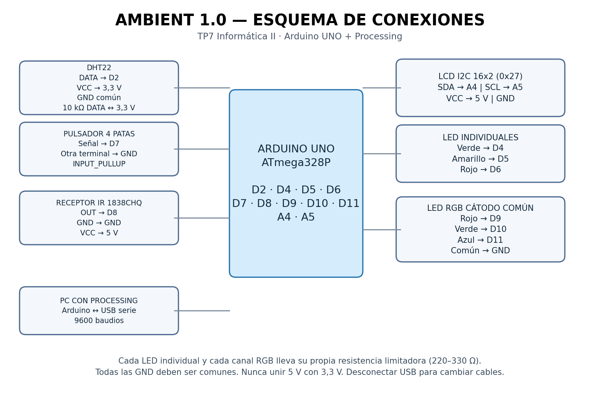

# AMBIENT – Supervisión ambiental

**Nombre y apellido:** Romina Olivera  
**Carrera:** Ingeniería en Telecomunicaciones  
**Facultad:** UTN Regional Mendoza  
**Video del equipo funcionando:** https://youtu.be/3cmP3AyCMxQ

## El proyecto

AMBIENT es un sistema de monitoreo de temperatura y humedad. Utiliza un Arduino UNO, un DHT22 y una pantalla LCD. Los tres LED de estado permiten reconocer rápidamente si las condiciones son normales, si hay una advertencia o si se superó un límite.

El equipo se puede manejar desde el pulsador o con un control infrarrojo. Cuando se conecta a una computadora, Processing permite observar las mediciones, consultar los gráficos, configurar los límites y conservar los registros en archivos CSV.

## Mantenimiento

La sección **MANTENIMIENTO** de Processing permite revisar el pulsador y la señalización del equipo sin intervenir sobre las alarmas ambientales.

Desde allí se puede probar por separado cada canal del LED RGB para comprobar visualmente las conexiones. También hay una secuencia de verificación de cuatro segundos (rojo, verde, azul y violeta) y una función para **localizar el equipo**: el RGB emite una señal violeta durante siete segundos. Esto puede resultar útil al revisar varias unidades o identificar cuál está conectada a la PC.

Durante una prueba manual, el pulsador conectado a D7 permite avanzar entre los canales. Processing muestra la entrada digital en estado HIGH o LOW y el nivel lógico ordenado para D9, D10 y D11. Estas indicaciones muestran el estado de los pines, pero no sustituyen la comprobación visual de los LED.

Al pulsar **VOLVER A AUTO**, o cuando vence el tiempo de prueba, el RGB vuelve a indicar la comunicación con la PC y la recepción de órdenes infrarrojas. El semáforo ambiental de D4, D5 y D6 sigue funcionando por separado.

## Archivos

- `Arduino/`: programa del Arduino UNO, clase de control y gestión de configuración.
- `Processing/`: interfaz de supervisión, gráficos e historial.
- `Documentacion/`: esquema de conexiones y diagrama general.

## Para ejecutarlo

1. Abrir `Arduino/EstacionDHT22/EstacionDHT22.ino` y cargarlo en Arduino UNO.
2. Ejecutar `Processing/PanelDHT22/PanelDHT22.pde`.
3. Cerrar el Monitor Serie de Arduino IDE y conectar el puerto COM desde Processing.
4. Entrar en las secciones de supervisión, alarmas o mantenimiento según lo que se necesite hacer.

Los pasos de instalación y las bibliotecas necesarias están detallados en los README de cada carpeta.

## Esquema

## Demostración

El video muestra el circuito funcionando, el envío de mediciones hacia Processing, la configuración de límites, el estado del pulsador, la verificación de los canales RGB desde la computadora y la respuesta al pulsador físico.
